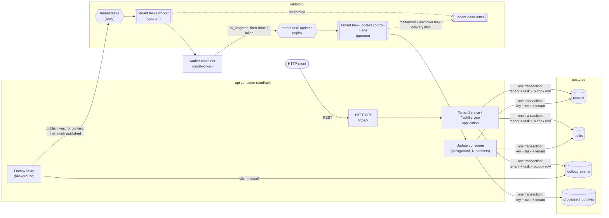
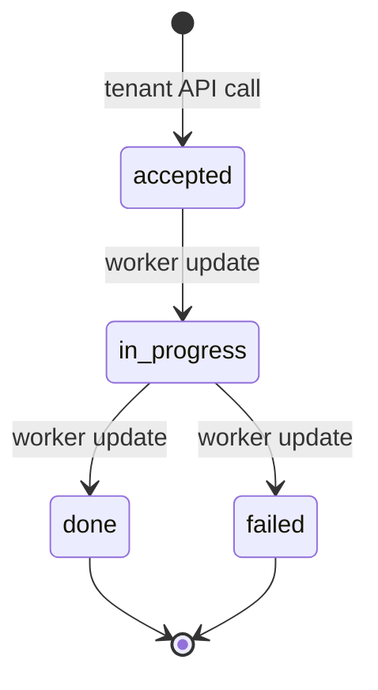
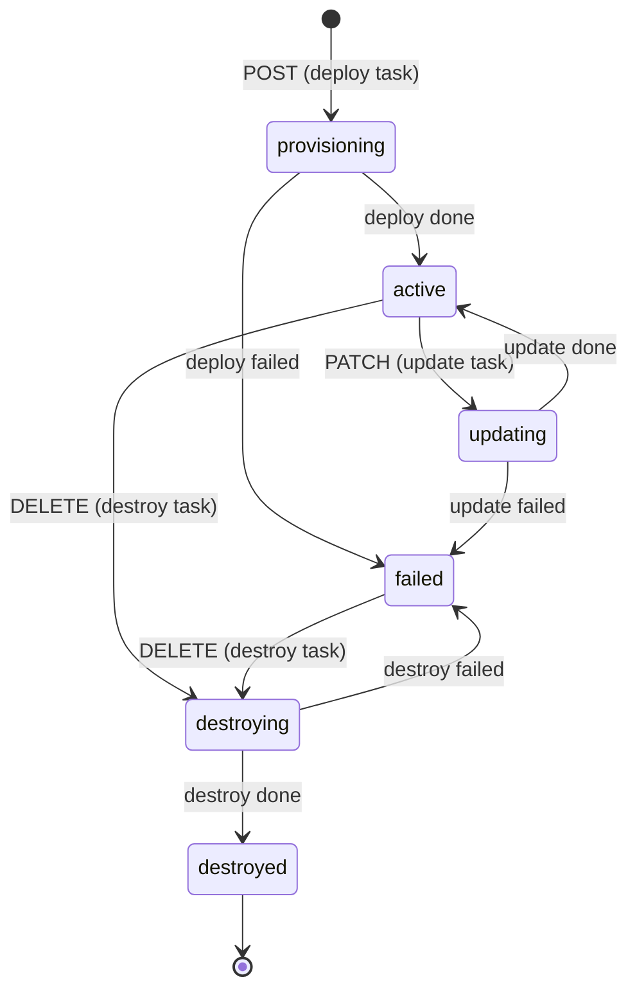
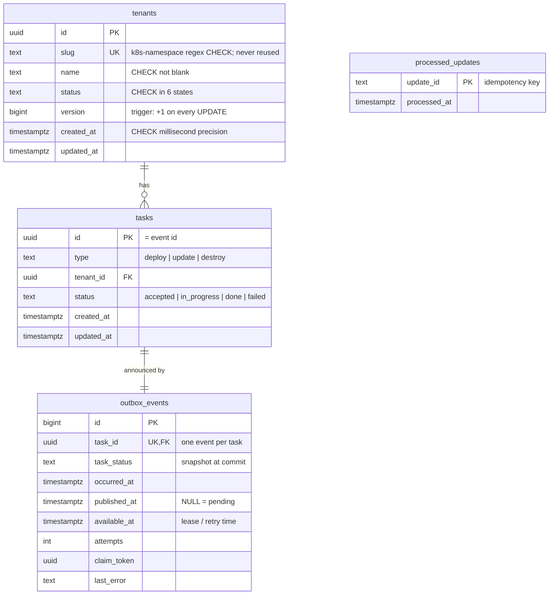

# Tenant Provisioning Control Plane

A control-plane service for a multi-tenant SaaS. It records tenants in
PostgreSQL and turns every tenant mutation into a task. Each task is
published to RabbitMQ through a transactional outbox. A separate worker
simulator processes the task, and the progress it reports back is applied
idempotently and order-tolerantly.

Written in Go 1.26. Everything runs locally in Docker.

```bash
git clone https://github.com/uttamsingh23/tenant-control-plane.git && cd tenant-control-plane
make up      # builds and boots postgres, rabbitmq, api and worker; waits until healthy
make check   # gofmt, go vet, golangci-lint (+gosec), govulncheck, go test -race ./...
```

---

## Contents

1. [Quick start](#1-quick-start)
2. [Architecture](#2-architecture)
3. [Technology choices and trade-offs](#3-technology-choices-and-trade-offs)
4. [Package responsibilities](#4-package-responsibilities)
5. [State machines](#5-state-machines)
6. [Database schema and migrations](#6-database-schema-and-migrations)
7. [HTTP API](#7-http-api)
8. [Errors and HTTP status mapping](#8-errors-and-http-status-mapping)
9. [Optimistic locking](#9-optimistic-locking)
10. [Messaging: outbox, topology and message formats](#10-messaging-outbox-topology-and-message-formats)
11. [Inbound updates: idempotency and ordering](#11-inbound-updates-idempotency-and-ordering)
12. [Worker simulator](#12-worker-simulator)
13. [Walkthroughs](#13-walkthroughs)
14. [Tests and quality gates](#14-tests-and-quality-gates)
15. [Configuration reference](#15-configuration-reference)
16. [Troubleshooting](#16-troubleshooting)
17. [Known limitations](#17-known-limitations)

---

## 1. Quick start

### Prerequisites

| Tool | Version | Needed for |
| --- | --- | --- |
| Docker with Compose v2 | `docker compose` (v2, supports `--wait`) | `make up`, and the integration tests (testcontainers) |
| GNU or BSD `make` | any | every command below |
| Go | 1.21 or newer | `make check` / `make test`. `go.mod` pins `toolchain go1.26.9`, which the `go` command downloads automatically. |
| `curl`, `jq` | any | the walkthrough scripts |

`make up` does not need Go: the binaries are built inside Docker.

### Boot

```bash
make up
```

This command:

1. creates `.env` from `.env.example` if it is missing (local-only throwaway credentials, git-ignored)
2. builds one image holding both binaries (`Dockerfile`)
3. starts `postgres` and `rabbitmq` and waits for their health checks
4. starts `api`, which applies migrations and then serves on <http://localhost:8080>, and waits until `GET /healthz` answers
5. starts `worker`, once the api is healthy

`docker compose up --wait` returns only when every service is running and
healthy, and exits non-zero otherwise. Every service has
`restart: unless-stopped`, so a crashed api or worker comes back. Postgres
and RabbitMQ data live in named volumes, so tenants survive `make down` /
`make up`.

```bash
make ps                  # container status and health
make logs                # follow api + worker logs (JSON, one line per event)
curl -s localhost:8080/healthz   # {"status":"ok"}
```

RabbitMQ management UI: <http://localhost:15672>. The user and password are
`RABBITMQ_USER` / `RABBITMQ_PASSWORD` from your `.env`.

### Test

```bash
make check   # every quality gate; exits non-zero on the first failure
make test    # just the suite: go test -race -count=1 ./...
```

The integration tests start their own throwaway PostgreSQL and RabbitMQ
containers with testcontainers, so they do not touch the stack from
`make up` and do not need it running. See [Tests and quality gates](#14-tests-and-quality-gates).

### See it work

```bash
make smoke   # one tenant: create -> active -> PATCH -> active -> DELETE -> destroyed
make replay  # duplicate / out-of-order / poison updates published straight to RabbitMQ
make race-check RACECHECK_ARGS="-n 64 -rounds 3"   # concurrent creates/PATCHes/DELETEs against the stack
```

### Stop

```bash
make down    # stop everything, keep data
make clean   # stop everything and delete the data volumes
```

`make help` lists every target.

---

## 2. Architecture



The happy path of a create:

1. `POST /v1/tenants` runs one PostgreSQL transaction. It inserts the
   tenant (`provisioning`, v1), its `deploy` task (`accepted`) and an
   `outbox_events` row, then commits. The client gets `201` immediately.
2. The **outbox relay** in the api process claims the committed row and
   publishes the task to `tenant.tasks`. It waits for the broker's
   publisher confirm and only then marks the row published.
3. The **worker** consumes the task, sleeps, publishes `in_progress`,
   sleeps again, and publishes `done` (or `failed`, with probability
   `--fail-rate`). It acks the task only after both updates are confirmed.
4. The **update consumer** in the api process applies each update in one
   transaction. That transaction records the update's idempotency key,
   advances the task, and on a terminal outcome moves the tenant
   (`active`, v2). The delivery is acked after the commit.

There is one deployable image with two commands. The control plane is a
single process: HTTP server, outbox relay and update consumer share one
connection pool. It can be scaled horizontally, because relays coordinate
through leases and consumers compete on one queue.

---

## 3. Technology choices and trade-offs

| Choice | Why | Trade-off accepted |
| --- | --- | --- |
| **Go 1.26, `net/http` `ServeMux`** (method + path patterns) | Routing with path params is in the standard library now. No framework to learn or justify. | Middleware (request IDs, panics, timeouts, logging) is hand-written, about 150 lines. |
| **PostgreSQL 17 + pgx v5** | Transactions, row locks, `FOR UPDATE SKIP LOCKED`, partial unique indexes and triggers give the invariants a second line of defence below the code. | Hand-written SQL rather than an ORM. More code, but every query is visible and reviewable. |
| **goose migrations, embedded** (`migrations/*.sql` via `embed.FS`) | The binary carries its schema. The api migrates on startup under an advisory lock, so replicas starting together are safe. | No separate migration job. A bad migration blocks api startup, which is visible immediately rather than silent. |
| **RabbitMQ 4.1, quorum queues, publisher confirms** | Durable, replicated queues. Per-message ack/nack/reject. A built-in dead-letter exchange and a delivery limit that bounds poison messages. A management HTTP API good enough to replay messages by hand. | No log or replay like Kafka. Ordering is per queue, not per tenant, so ordering is handled in the consumer (see [§11](#11-inbound-updates-idempotency-and-ordering)). |
| **Transactional outbox + polling relay** | The only way to get "published if and only if committed" without distributed transactions. Polling is simple and needs no CDC infrastructure. | Up to `OUTBOX_POLL_INTERVAL` (500ms) of extra latency, and at-least-once publication (duplicates are possible and handled). |
| **Idempotency table + state-machine guards** on the consumer | Dedup by key handles redelivery. The state machine handles different keys describing stale or contradicting progress. | `processed_updates` grows forever (see [limitations](#17-known-limitations)). |
| **Optimistic locking** with `version` in the PATCH body | No locks held across requests, and a stale write fails loudly. The version is checked in the `WHERE` clause, so it is atomic. | The client has to re-read and retry on `409`. `If-Match`/ETag would be the more HTTP-native carrier, but the body keeps the precondition next to the change. |
| **Soft delete** (`destroyed` is a status) | Slugs must stay unique "including against destroyed tenants". Keeping the row makes that a plain `UNIQUE` constraint and keeps task history traceable. | The table never shrinks. |
| **testcontainers** for integration tests | `make test` needs nothing running and cannot collide with the dev stack. Every test gets its own database and vhost. | Tests need Docker, and the first run pulls images. |
| **Docker Compose + Makefile** | Everything a reviewer needs in two commands with tools they already have. | Make is not ideal on Windows (WSL works). |
| **Alpine runtime image** | Small, and has busybox `wget` for the compose health check. | Larger attack surface than distroless. The binaries are static and run as a non-root user. |

---

## 4. Package responsibilities

```
cmd/
  api/              composition root of the control plane: config, pool, migrations, relay, consumer, HTTP server
  worker/           composition root of the worker simulator
  racecheck/        black-box concurrency checker run against a live stack (make race-check)
internal/
  domain/           Tenant and Task entities, their state machines, validation and error sentinels; no I/O
  application/      use cases (TenantService, TaskService, OutboxRelay) and the ports (interfaces) they need
  config/           environment / CLI flag loading and validation, no I/O
  adapters/
    httpapi/        REST routing, JSON encoding, error -> status mapping, middleware, server lifecycle
    postgres/       repositories, transactions, outbox store, keyset pagination, migration runner (pgx)
    rabbitmq/       topology, task publisher/consumer, update publisher/consumer, message codecs
  worker/           provisioning simulator: delays, outcomes, stable update IDs
  testsupport/
    pgtest/         per-test PostgreSQL databases (testcontainers or TEST_DATABASE_URL)
    amqptest/       per-test RabbitMQ vhosts and topologies (testcontainers or TEST_RABBITMQ_URL)
    tcpproxy/       TCP proxy that refuses, cuts or blackholes connections to inject broker failures
migrations/         goose SQL migrations, embedded into the api binary
docs/schemas/       JSON Schemas of the task event and the progress update (tests validate against them)
scripts/            lifecycle.sh (make smoke) and replay.sh (make replay)
tests/              end-to-end tests: real router, services, PostgreSQL and RabbitMQ
```

Dependencies point inwards: `adapters → application → domain`. Interfaces
are declared by the package that consumes them (Go idiom):

| Interface | Declared in | Implemented by |
| --- | --- | --- |
| `TenantRepository`, `TaskRepository`, `OutboxRepository`, `ProcessedUpdateRepository`, `Transactor` | `application` | `postgres.Store` |
| `TaskPublisher` | `application` | `rabbitmq.TaskPublisher` |
| `TenantService`, `TaskService` | `httpapi` | `application.*Service` |
| `UpdateApplier`, `TaskHandler` | `rabbitmq` | `application.TaskService`, `worker.Simulator` |
| `UpdatePublisher` | `worker` | `rabbitmq.UpdatePublisher` |

---

## 5. State machines

### Task



`done` and `failed` are terminal. A database trigger refuses any update
to a terminal task, so not even a buggy code path can regress one.

### Tenant



| From | API call allowed | Resulting task |
| --- | --- | --- |
| `provisioning`, `updating`, `destroying` | none (task in flight) → `409 tenant_update_not_allowed` | — |
| `active` | PATCH → `updating`; DELETE → `destroying` | `update` / `destroy` |
| `failed` | DELETE → `destroying` (PATCH → 409) | `destroy` |
| `destroyed` | none → 409; GET still returns it | — |

Only **terminal** task outcomes move a tenant: deploy `done` → `active`,
update `done` → `active`, destroy `done` → `destroyed`, any `failed` →
`failed`. `in_progress` changes the task only.

**At most one open task per tenant** falls out of the guards: every state
that has an open task refuses new mutations. A partial unique index
(`tasks_one_open_per_tenant_idx`) backs this up in the database.

The rules live in `internal/domain/tenant.go` and `task.go`, as pure
functions with table-driven tests.

---

## 6. Database schema and migrations



Database-level guarantees (they hold even if the Go code were wrong):

| Object | Enforces |
| --- | --- |
| `tenants_slug_key` (UNIQUE over all rows) | one winner for concurrent same-slug creates; destroyed slugs stay taken |
| `tenants_guard_update` trigger | `version` increases by exactly 1 on every update; `id`, `slug`, `created_at` immutable |
| `tasks_guard_update` trigger | terminal tasks are frozen; `id`, `type`, `tenant_id`, `created_at` immutable |
| `tasks_one_open_per_tenant_idx` (partial UNIQUE) | at most one `accepted`/`in_progress` task per tenant |
| `outbox_events_task_id_key` | exactly one event per task |
| `processed_updates` PK | an update key is applied at most once, even by concurrent consumers |
| CHECK constraints | slug format, non-blank name, valid enums, millisecond timestamps |

### Migrations

| File | Adds |
| --- | --- |
| `00001_create_tenants.sql` | `tenants`, indexes for keyset pagination, version/identity trigger |
| `00002_create_tasks.sql` | `tasks`, one-open-task index, terminal-freeze trigger |
| `00003_create_outbox_events.sql` | `outbox_events` |
| `00004_create_processed_updates.sql` | `processed_updates` |
| `00005_add_outbox_delivery_state.sql` | lease, attempts, claim token and last error on the outbox |

- **Running them:** automatic. The api applies pending migrations on
  startup (`postgres.Migrate`), each in its own transaction, under a
  PostgreSQL advisory lock, so concurrent api starts are safe. The test
  harness applies them the same way to every test database.
- **Checking them:**
  `docker compose exec postgres sh -c 'psql -U "$POSTGRES_USER" -d "$POSTGRES_DB" -c "select version_id, is_applied from goose_db_version order by id"'`
- **Adding one:** create `migrations/0000N_description.sql` with
  `-- +goose Up` / `-- +goose Down` sections. Never edit a committed
  migration. Restart the api (`docker compose up -d --build api`) to apply
  it. `TestMigrationsDownAndUpAgain` checks that down and up again work, and
  `TestMigrateConcurrentCallers` that concurrent starts are safe.
- **Starting over:** `make clean && make up` drops the volume and
  re-applies everything.

---

## 7. HTTP API

JSON in and out. Request bodies need `Content-Type: application/json`.
Timestamps are ISO 8601 UTC with milliseconds (`2026-10-14T20:47:52.459Z`).
Every response carries an `X-Request-ID`. A valid client-supplied one is
echoed back; otherwise one is generated.

| Method | Path | Description | Success |
| --- | --- | --- | --- |
| GET | `/healthz` | Liveness | 200 |
| POST | `/v1/tenants` | Create a tenant and its `deploy` task | 201 + `Location: /v1/tenants/{id}` |
| GET | `/v1/tenants` | List tenants (`status`, `limit`, `cursor`) | 200 |
| GET | `/v1/tenants/{tenantID}` | Get a tenant (destroyed tenants included) | 200 |
| PATCH | `/v1/tenants/{tenantID}` | Partial update (`name`) with `version`; creates an `update` task | 202 + `Location: /v1/tasks/{id}` |
| DELETE | `/v1/tenants/{tenantID}` | Request destruction; creates a `destroy` task | 202 + `Location: /v1/tasks/{id}` |
| GET | `/v1/tasks` | List tasks (`tenant_id`, `status`, `limit`, `cursor`) | 200 |
| GET | `/v1/tasks/{taskID}` | Get a task | 200 |

PATCH and DELETE return **202 Accepted**: the change is recorded, but the
work it triggers is asynchronous. Tasks are read-only over HTTP.

### Create

```bash
curl -si -XPOST localhost:8080/v1/tenants -H 'Content-Type: application/json' \
  -d '{"slug":"acme","name":"Acme"}'
```

```http
HTTP/1.1 201 Created
Location: /v1/tenants/03784000-31c3-4f59-b759-3a0e0c322eaa
X-Request-Id: cffe4696-ad17-4a3f-a4ac-94544ebde9ba
```

```json
{
  "tenant": { "id": "03784000-31c3-4f59-b759-3a0e0c322eaa", "slug": "acme", "name": "Acme",
              "status": "provisioning", "version": 1,
              "created_at": "2026-10-14T20:47:52.459Z", "updated_at": "2026-10-14T20:47:52.459Z" },
  "task":   { "id": "c70d3375-ec3e-46e2-9330-ac3137be4db3", "type": "deploy",
              "tenant_id": "03784000-31c3-4f59-b759-3a0e0c322eaa", "status": "accepted",
              "created_at": "2026-10-14T20:47:52.459Z", "updated_at": "2026-10-14T20:47:52.459Z" }
}
```

- `slug` must be 3-28 characters matching `^[a-z][-a-z0-9]{1,26}[a-z0-9]$`.
  It is unique forever, so a destroyed tenant keeps its slug.
- `name` must not be blank.
- Any other field is rejected with `400`.

### Get and list

```bash
curl -s localhost:8080/v1/tenants/03784000-31c3-4f59-b759-3a0e0c322eaa
```

```json
{ "id": "03784000-31c3-4f59-b759-3a0e0c322eaa", "slug": "acme", "name": "Acme", "status": "active",
  "version": 2, "created_at": "2026-10-14T20:47:52.459Z", "updated_at": "2026-10-14T20:47:55.466Z" }
```

```bash
curl -s 'localhost:8080/v1/tasks?tenant_id=03784000-31c3-4f59-b759-3a0e0c322eaa'
```

```json
{ "items": [ { "id": "c70d3375-ec3e-46e2-9330-ac3137be4db3", "type": "deploy",
               "tenant_id": "03784000-31c3-4f59-b759-3a0e0c322eaa", "status": "done",
               "created_at": "2026-10-14T20:47:52.459Z", "updated_at": "2026-10-14T20:47:55.466Z" } ] }
```

Pagination and filtering (both lists):

```bash
curl -s 'localhost:8080/v1/tenants?status=active&limit=20'
curl -s 'localhost:8080/v1/tenants?limit=20&cursor=<next_cursor from the previous page>'
curl -s 'localhost:8080/v1/tasks?tenant_id=<id>&status=in_progress'
```

| Parameter | Endpoints | Meaning |
| --- | --- | --- |
| `limit` | both | page size 1-200, default 50 |
| `cursor` | both | opaque `next_cursor` from the previous page; `next_cursor` is omitted on the last page |
| `status` | both | exact match; must be a valid status of that resource |
| `tenant_id` | `/v1/tasks` | tasks of one tenant; an unknown tenant gives an empty list |

- Lists are oldest first. Pagination is keyset-based (`created_at, id`),
  so pages stay stable while rows are inserted.
- Filters combine with AND.
- Unknown or repeated parameters, an out-of-range `limit`, an invalid
  `status` or a malformed `cursor` give `400 invalid_request`. A typo is
  rejected rather than silently ignored.

### Update (PATCH)

```bash
curl -si -XPATCH localhost:8080/v1/tenants/03784000-31c3-4f59-b759-3a0e0c322eaa \
  -H 'Content-Type: application/json' -d '{"name":"Acme Corp","version":2}'
```

```http
HTTP/1.1 202 Accepted
Location: /v1/tasks/9285becc-2307-4469-98dd-29ec1cd96b7f
```

```json
{ "tenant": { "id": "03784000-…", "slug": "acme", "name": "Acme Corp", "status": "updating", "version": 3, "…": "…" },
  "task":   { "id": "9285becc-2307-4469-98dd-29ec1cd96b7f", "type": "update", "status": "accepted", "…": "…" } }
```

- `version` is required. See [Optimistic locking](#9-optimistic-locking).
- `name` is the only patchable field. Omitted fields are unchanged, and
  `null` is rejected. `slug` is immutable, so sending it gives `400`.

### Delete

```bash
curl -si -XDELETE localhost:8080/v1/tenants/03784000-31c3-4f59-b759-3a0e0c322eaa
```

```http
HTTP/1.1 202 Accepted
Location: /v1/tasks/8e78c62f-d9d9-4644-8a30-c3c9440ab3bd
```

```json
{ "tenant": { "…": "…", "status": "destroying", "version": 5 },
  "task":   { "…": "…", "type": "destroy", "status": "accepted" } }
```

DELETE **requests** destruction. It is allowed from `active` or `failed`.
The row is kept: after the worker reports `done` the tenant reads as
`destroyed`, and GET still returns it rather than 404. Repeating a DELETE
gets `409 tenant_update_not_allowed` and never creates a second destroy
task.

---

## 8. Errors and HTTP status mapping

Every error, including unknown routes, wrong methods and recovered panics,
has one shape:

```json
{ "error": { "code": "invalid_request", "message": "invalid slug: must be 3-28 characters, got 1", "field": "slug" } }
```

`code` is the stable contract to branch on. `message` is for humans.
`field` is present when one body field or query parameter is at fault.

| Code | HTTP | When |
| --- | --- | --- |
| `invalid_request` | 400 | malformed JSON; missing, null, mistyped or unknown field; invalid slug or name; missing `version`; bad query parameter |
| `tenant_not_found` | 404 | no tenant with that ID (a malformed ID too) |
| `task_not_found` | 404 | no task with that ID |
| `route_not_found` | 404 | no such path |
| `method_not_allowed` | 405 | path exists, method does not (the `Allow` header lists valid ones) |
| `tenant_already_exists` | 409 | slug taken, including by a destroyed tenant, or lost a concurrent same-slug create |
| `tenant_update_not_allowed` | 409 | PATCH or DELETE not allowed in the tenant's current status |
| `tenant_version_conflict` | 409 | the `version` sent is stale, or the tenant changed between read and write |
| `payload_too_large` | 413 | body over 1 MiB |
| `unsupported_media_type` | 415 | body not sent as `application/json` |
| `internal_error` | 500 | anything unexpected; details are logged with the request ID, never returned |
| `request_timeout` | 503 | the request exceeded `HTTP_REQUEST_TIMEOUT` |

Real responses from the running stack:

```text
POST  same slug again              -> 409 {"error":{"code":"tenant_already_exists","message":"tenant already exists"}}
PATCH with version 1 (current: 2)  -> 409 {"error":{"code":"tenant_version_conflict","message":"tenant version conflict"}}
PATCH while updating               -> 409 {"error":{"code":"tenant_update_not_allowed","message":"tenant update not allowed in current status"}}
GET   /v1/tenants/<unknown uuid>   -> 404 {"error":{"code":"tenant_not_found","message":"tenant not found"}}
GET   /v1/tasks/nope               -> 404 {"error":{"code":"task_not_found","message":"task not found"}}
```

The three 409s share a status because each means "conflicts with the
tenant's current state"; the code tells them apart. The whole mapping is
one function, `classify` in
[`internal/adapters/httpapi/errors.go`](internal/adapters/httpapi/errors.go).

---

## 9. Optimistic locking

Every tenant write is a conditional update:

```sql
UPDATE tenants SET ..., version = version + 1 WHERE id = $1 AND version = $2
```

Zero rows affected means someone else wrote first, and the call fails with
`409 tenant_version_conflict`. No change is made and no task or outbox row
is written, because the whole call is one transaction.

- **Every mutation bumps `version`**: create (1), PATCH, DELETE, and every
  tenant change applied from a worker outcome. A database trigger rejects
  any update that does not increase it by exactly one, whoever the writer
  is.
- **PATCH takes the expected version in the body.** The client sends the
  `version` it last read. If the worker has finished a task since then,
  the version has moved, and the client must re-read before patching.
  That is deliberate: the client was looking at a stale state.
- **Order of checks:** version first, then status. A stale version gives
  `tenant_version_conflict`. A current version on a non-`active` tenant
  gives `tenant_update_not_allowed`.
- **Concurrency:** of N simultaneous PATCHes carrying the same version,
  exactly one gets `202` and the rest get `409 tenant_version_conflict`.
  This is proven by `TestConcurrentPatchesWithSameVersion` (HTTP + real
  PostgreSQL), `TestAppConcurrentUpdatesSameVersion`, and `make race-check`
  against the live stack.
- **DELETE** takes no version from the client, but it is still a
  conditional write on the version it just read. A DELETE racing a PATCH
  or another DELETE can therefore get `tenant_version_conflict` rather
  than `tenant_update_not_allowed`. Both mean "re-read and decide".
- **Worker-applied changes** use the same version check, under the task's
  row lock.

---

## 10. Messaging: outbox, topology and message formats

### Outbound: transactional outbox

Every state-changing API call publishes exactly one event, and only after
the change is durably committed:

```
 HTTP request
     └─ TenantService ── one transaction ──────────────────────────┐
           INSERT/UPDATE tenants                                   │
           INSERT tasks                                            │
           INSERT outbox_events (task_id, status snapshot)         │
        COMMIT ────────────────────────────────────────────────────┘  -> 201/202 to the client

 OutboxRelay (background, one per api replica)
     1. claim    UPDATE outbox_events SET available_at = now()+lease, claim_token = ...
                 WHERE published_at IS NULL AND available_at <= now() ... FOR UPDATE SKIP LOCKED   (own committed statement)
     2. publish  -> tenant.tasks, wait for the publisher confirm   (no transaction open)
     3. mark     UPDATE outbox_events SET published_at = now()       (only after the confirm)
        failure: attempts+1, last_error, available_at = now()+backoff
```

Why an outbox: the database and the broker share no transaction.

| Approach | Failure | Result |
| --- | --- | --- |
| publish, then commit | commit fails or the process dies | the worker provisions a tenant that does not exist |
| commit, then publish in the request | broker down, or the process dies after commit | event lost; tenant stuck in `provisioning` forever |
| **outbox** | anything | the event exists if and only if the change committed, and is retried until the broker confirms it |

Properties:

- **Rollback leaves nothing.** The outbox row is in the same transaction
  as the tenant and task (`TestAppMutationsRollBack`).
- **Only committed rows are visible.** The claim runs under READ
  COMMITTED, and it selects by `published_at IS NULL` rather than "id
  above the last one seen", so a late-committing transaction is not
  skipped.
- **No transaction is held while talking to the broker.** The lease
  (`OUTBOX_LEASE`) keeps other relays off a claimed row. If the relay
  dies, the lease expires and the row is claimed again
  (`TestOutboxAbandonedClaimIsRedelivered`).
- **Several relays are safe.** `SKIP LOCKED` plus the lease keeps
  concurrent claims disjoint (`TestOutboxConcurrentRelays`). Lease and
  retry times use the database clock.
- **Nothing is discarded.** Retries use exponential backoff with jitter
  (`OUTBOX_RETRY_MIN`..`MAX`), with no attempt limit. Stuck events show up
  with `SELECT task_id, attempts, last_error FROM outbox_events WHERE published_at IS NULL`.
- **Broker down at startup is fine.** The api serves requests, events
  accumulate, and they are published once the broker is reachable.

**Still at-least-once.** A crash between the confirm and the mark, a lost
confirm, or an expired lease re-publishes the event. Every copy is
byte-identical, and the task ID is the AMQP `message_id`, so consumers
deduplicate (see [§11](#11-inbound-updates-idempotency-and-ordering) and
[§12](#12-worker-simulator)).

### Broker topology

| Object | Name | Properties |
| --- | --- | --- |
| Exchange | `tenant.tasks` | topic, durable; routing key `task.<type>` |
| Queue | `tenant.tasks.worker` | quorum, bound `task.#`, dead-letters to `tenant.dead-letter` |
| Exchange | `tenant.task-updates` | topic, durable; routing key `task_update.<status>` |
| Queue | `tenant.task-updates.control-plane` | quorum, bound `task_update.#`, dead-letters to `tenant.dead-letter` |
| Exchange + queue | `tenant.dead-letter` | fanout + quorum queue: rejected messages and messages over the delivery limit (20) |

Both processes declare the whole topology on every connect, so start
order does not matter. Messages are persistent and published with
`mandatory` and publisher confirms.

### Task event (control plane → worker)

AMQP `message_id` = task ID, `type` = `task`, `app_id` =
`tenant-control-plane`, `delivery_mode` = 2. The body is the task as
committed (schema:
[`docs/schemas/task-event.v1.json`](docs/schemas/task-event.v1.json)):

```json
{ "id": "c70d3375-ec3e-46e2-9330-ac3137be4db3", "type": "deploy",
  "tenant_id": "03784000-31c3-4f59-b759-3a0e0c322eaa", "status": "accepted",
  "created_at": "2026-10-14T20:47:52.459Z", "updated_at": "2026-10-14T20:47:52.459Z" }
```

### Progress update (worker → control plane)

Schema: [`docs/schemas/task-update.v1.json`](docs/schemas/task-update.v1.json).
`messages_test.go` validates every encoded update against it.

| Field | Meaning |
| --- | --- |
| `schema_version` | `1` |
| `message_id` | **idempotency key**: `<task_id>:in_progress` or `<task_id>:outcome` |
| `task_id` | the task this update is about |
| `tenant_id`, `task_type` | echo the task, so the consumer can check the update against its record |
| `previous_status` → `status` | `accepted → in_progress`, or `in_progress → done \| failed` (the schema enforces these pairs) |
| `reason` | only on `failed` |
| `occurred_at` | ISO 8601, ms, `Z` |

AMQP `message_id` = body `message_id`, `correlation_id` = `task_id`.

```json
{"schema_version":1,"message_id":"c70d…:in_progress","task_id":"c70d…","tenant_id":"0378…",
 "task_type":"deploy","previous_status":"accepted","status":"in_progress","occurred_at":"2026-10-14T20:47:53.901Z"}
{"schema_version":1,"message_id":"c70d…:outcome","task_id":"c70d…","tenant_id":"0378…",
 "task_type":"deploy","previous_status":"in_progress","status":"done","occurred_at":"2026-10-14T20:47:55.466Z"}
```

**Why the IDs are derived, not random.** A redelivered task is simulated
again, and its updates must carry the same keys, or the control plane
could not recognise them as duplicates. The outcome has one key whether
it is `done` or `failed`. If a rerun draws a different outcome, it is a
duplicate of the first one, and the first outcome recorded wins.

---

## 11. Inbound updates: idempotency and ordering

```
 tenant.task-updates.control-plane ──> UpdateConsumer (prefetch N, N handlers, manual ack)
        │                                 │ decode + validate against the schema
        │                                 │     └── malformed ──────────────────────────> reject ──> tenant.dead-letter
        │                                 v
        │                    ApplyUpdate, one PostgreSQL transaction:
        │                      1. INSERT message_id INTO processed_updates   (conflict => duplicate)
        │                      2. SELECT task FOR UPDATE; check tenant_id, task_type
        │                      3. advance task  (already reached or passed => stale / conflict)
        │                      4. terminal outcome: move tenant, version + 1 (optimistic lock)
        │                    COMMIT
        │                                 ├── applied | duplicate | stale | conflict ────> ack
        │                                 ├── permanent (task not found, mismatch) ─────> reject ──> tenant.dead-letter
        └──── requeue <── MaxAttempts ────┴── retryable (DB down, timeout) ──> backoff, retry in-process
```

Delivery is at-least-once; **applying** an update is idempotent. However
many times an update arrives, and in whatever order, the database ends in
the state it would reach if each logical update arrived exactly once and
in order. Three mechanisms make that hold:

1. **A stable key.** `message_id` is derived from the task, so every copy
   of a logical update carries the same key.
2. **Key and effect commit together.** The `processed_updates` row is in
   the same transaction as the state change. If it rolls back, the key
   goes with it, so the retry is applied rather than skipped. Concurrent
   copies block on the primary key: one commits, the others see
   `duplicate`.
3. **Ack after commit.** A crash between commit and ack causes a
   redelivery, which is found as `duplicate` and acked
   (`TestInboundCrashAfterCommitBeforeAck`).

Keys alone do not stop a *different* key describing stale or
contradicting progress, so the state machine is the second line of
defence:

| Situation | Outcome | Effect |
| --- | --- | --- |
| first delivery of a valid update | `applied` | task advances; on `done`/`failed` the tenant moves and `version` + 1 |
| same `message_id` again | `duplicate` | none |
| task already at or past that status (`in_progress` after `done`) | `stale` | none, key recorded |
| terminal outcome contradicting the recorded one (`failed` after `done`) | `conflict` | none, key recorded, WARN logged; the first outcome wins |
| outcome arrives before its `in_progress` | `applied` | task steps `accepted → in_progress → done` in one transaction; the late `in_progress` is then `stale` |
| update for a terminal task after its tenant moved on | `stale` | none; the tenant is not dragged back |
| unknown task, or `tenant_id`/`task_type` mismatch | dead-lettered | none; key not recorded, so it can be replayed once fixed |
| malformed (not JSON, bad schema, illegal transition, bad timestamp) | dead-lettered | none |

**Poison messages never kill the consumer.** Malformed and permanently
failing messages are rejected to `tenant.dead-letter` at once. Transient
failures (database down) are retried with backoff, up to
`INBOUND_MAX_ATTEMPTS` in-process attempts. After that the delivery is
requeued so it cannot hold a slot forever. The quorum queue's delivery
limit (20) is the final bound: a message failing every time is
eventually dead-lettered, never looped forever.

**Concurrency.** `INBOUND_CONCURRENCY` handlers (default 4) share one
channel. Updates for one task are serialised by the task row lock, and
several api replicas can consume the same queue. On SIGTERM, in-flight
updates get `INBOUND_SHUTDOWN_TIMEOUT` to commit and ack; the rest are
requeued.

---

## 12. Worker simulator

`cmd/worker` is a separate process with no HTTP API and no database. It
consumes `tenant.tasks.worker` with prefetch 1. For each task it:

1. waits a random delay in `[--min-delay-ms, --max-delay-ms]`
2. publishes `in_progress`
3. waits again
4. publishes `done`, or `failed` with probability `--fail-rate`
5. **acks only after both updates are broker-confirmed**

Reliability:

- **Crash or kill mid-task:** the task is unacked, RabbitMQ redelivers it,
  and it is re-run with the same update IDs, so the control plane
  discards the duplicates.
- **Publish failure:** the task is requeued after a 1s pause.
- **Malformed task:** rejected to the dead-letter queue, and the worker
  carries on.
- **Broker down:** the worker reconnects with capped backoff (500ms to 30s).
- **SIGTERM:** the in-flight task gets `--shutdown-timeout` (10s) to
  finish; otherwise it is requeued.

Flags (each has a `WORKER_*` environment variable equivalent; flags win):

| Flag | Default | Meaning |
| --- | --- | --- |
| `--fail-rate` | `0` | probability in [0,1] that a task ends `failed` |
| `--min-delay-ms` / `--max-delay-ms` | `500` / `2000` | range of each of the two waits; `0`/`0` is instant |
| `--seed` | `0` (random) | same seed + same task sequence = same delays and outcomes; the seed in use is logged |
| `--shutdown-timeout` | `10s` | grace for the in-flight task on SIGTERM |

Invalid values (rate outside [0,1], min > max, negative delays) stop the
worker at startup with every problem listed.

In compose, restart the worker with different flags:

```bash
make worker WORKER_ARGS="--fail-rate=1"
make worker WORKER_ARGS="--fail-rate=0.3 --min-delay-ms=0 --max-delay-ms=200 --seed=42"
make worker                     # back to the defaults
```

`make worker` recreates only the worker container (`--no-deps
--force-recreate`). An unacked in-flight task goes back to the queue and
is picked up by the new worker.

---

## 13. Walkthroughs

All commands assume `make up` has finished. The scripts exit non-zero if
any step ends in the wrong state, so they double as smoke tests.

### Successful lifecycle

```bash
make smoke
```

```text
== POST /v1/tenants slug=demo-1792010590-5432
{"tenant":{"status":"provisioning","version":1},"task":{"type":"deploy","status":"accepted"}}
{"slug":"demo-1792010590-5432","status":"active","version":2}
{"type":"deploy","status":"done"}
== PATCH name, version=2
{"tenant":"updating","task":"update"}
{"slug":"demo-1792010590-5432","status":"active","version":4}
{"type":"deploy","status":"done"}
{"type":"update","status":"done"}
== DELETE
{"tenant":"destroying","task":"destroy"}
{"slug":"demo-1792010590-5432","status":"destroyed","version":6}
{"type":"deploy","status":"done"}
{"type":"update","status":"done"}
{"type":"destroy","status":"done"}
== POST the same slug again
409 tenant_already_exists
OK: tenant afa74a33-3f94-4d91-8eaf-c6d9f5e9a30b
```

The version goes 1 → 2 (deploy done) → 3 (PATCH) → 4 (update done) → 5
(DELETE) → 6 (destroy done). Worker-applied changes count as mutations.

By hand, watching each step (`watch` is not on macOS by default:
`brew install watch`):

```bash
SLUG="by-hand-$RANDOM"   # slugs are unique forever, so a fixed one only works once
ID=$(curl -s -XPOST localhost:8080/v1/tenants -H 'Content-Type: application/json' \
  -d "{\"slug\":\"$SLUG\",\"name\":\"By hand\"}" | jq -r '.tenant.id // empty')
if [ -z "$ID" ]; then echo "create failed (slug taken or server down?)"; else
watch -n 0.5 "curl -s localhost:8080/v1/tenants/$ID | jq -c '{status,version}';
              curl -s 'localhost:8080/v1/tasks?tenant_id=$ID' | jq -c '.items[]|{type,status}'"
fi
# provisioning v1 / deploy accepted  ->  provisioning v1 / deploy in_progress  ->  active v2 / deploy done
# A fast worker may already be at active v2 / deploy done on the first refresh.
```

### Failure scenario: `--fail-rate=1`

```bash
make worker WORKER_ARGS="--fail-rate=1"
scripts/lifecycle.sh failed
```

```text
== POST /v1/tenants slug=demo-1792010619-5683
{"tenant":{"status":"provisioning","version":1},"task":{"type":"deploy","status":"accepted"}}
{"slug":"demo-1792010619-5683","status":"failed","version":2}
{"type":"deploy","status":"failed"}
== DELETE the failed tenant (worker still fails, so it ends failed again)
{"tenant":"destroying","task":"destroy"}
{"slug":"demo-1792010619-5683","status":"failed","version":4}
{"type":"deploy","status":"failed"}
{"type":"destroy","status":"failed"}
OK: tenant 2b7cc203-d140-45d9-8631-ce7c97adfd6a
```

The worker log shows the reason:

```bash
docker compose logs worker | grep '"task finished"' | tail -2
# ..."task_type":"deploy","status":"failed","reason":"simulated deploy failure (fail rate 1)"
```

Back to success: `make worker`, then DELETE the failed tenant again. It
now reaches `destroyed`. An update failure (`active → updating → failed`)
works the same way: create with the default worker, then
`make worker WORKER_ARGS="--fail-rate=1"` and PATCH.

### Duplicate and out-of-order messages

```bash
make replay
```

```text
tenant c9be8b1a-… is {"status":"active","version":2}, deploy task 89a06b49-…
duplicate:   the worker's own outcome again (same message_id)
out of order: in_progress after done, new message_id
conflict:    failed after done
unknown task (dead-lettered)
malformed body (dead-lettered)
tenant now {"status":"active","version":2}, task done, dead letters 0 -> 2
OK: duplicates and stale updates changed nothing; poison messages were dead-lettered and the consumer kept going
```

The api log shows how each one was classified (`make logs`):

```text
"msg":"duplicate task update ignored","message_id":"89a06b49-…:outcome"
"msg":"stale task update ignored","message_id":"manual-stale-13071","status":"in_progress"
"level":"WARN","msg":"conflicting task outcome ignored; the first outcome recorded stands"
"level":"ERROR","msg":"dead-lettering task update that can never be applied","message_id":"manual-ghost-18277"
"level":"ERROR","msg":"dead-lettering malformed task update","message_id":"garbage-1"
```

[`scripts/replay.sh`](scripts/replay.sh) publishes through RabbitMQ's own
management HTTP API (`POST /api/exchanges/%2F/tenant.task-updates/publish`).
Its `publish` function is the snippet to reuse for other scenarios:

```bash
set -a; . ./.env; set +a          # RABBITMQ_USER / RABBITMQ_PASSWORD
TASK=<task id>; TENANT=<tenant id>
jq -nc --arg id "manual-1" --arg task "$TASK" --arg tenant "$TENANT" '
  {schema_version:1, message_id:$id, task_id:$task, tenant_id:$tenant, task_type:"deploy",
   previous_status:"accepted", status:"in_progress", occurred_at:"2026-01-01T00:00:00.000Z"}
  | {properties:{message_id:$id, content_type:"application/json", delivery_mode:2},
     routing_key:"task_update.in_progress", payload:tojson, payload_encoding:"string"}' |
curl -s -u "$RABBITMQ_USER:$RABBITMQ_PASSWORD" -H 'Content-Type: application/json' \
  -XPOST localhost:15672/api/exchanges/%2F/tenant.task-updates/publish -d @-
# {"routed":true}
```

Inspect dead letters without consuming them:

```bash
curl -s -u "$RABBITMQ_USER:$RABBITMQ_PASSWORD" -H 'Content-Type: application/json' \
  -XPOST localhost:15672/api/queues/%2F/tenant.dead-letter/get \
  -d '{"count":10,"ackmode":"ack_requeue_true","encoding":"auto"}' |
  jq '.[] | {id: .properties.message_id, reason: .properties.headers["x-first-death-reason"]}'
```

**Out-of-order delivery of the worker's own updates:** with
`make worker WORKER_ARGS="--min-delay-ms=0 --max-delay-ms=0"`, the api's
`INBOUND_CONCURRENCY=4` handlers can pick up a task's `done` before its
`in_progress`. The result is still `accepted → in_progress → done`
and v2. `TestApplyUpdateOutOfOrder` and `TestInboundStaleDelivery` cover
this deterministically.

### Broker and database outages

```bash
# Broker down: the API keeps accepting work; events wait in the outbox and are published on recovery.
docker compose stop rabbitmq
curl -s -XPOST localhost:8080/v1/tenants -H 'Content-Type: application/json' -d '{"slug":"outage-demo","name":"x"}'
docker compose exec postgres sh -c 'psql -U "$POSTGRES_USER" -d "$POSTGRES_DB" \
  -c "select task_id, attempts, last_error from outbox_events where published_at is null"'
docker compose start rabbitmq     # ~15s later (broker boot + retry backoff) the tenant is active

# Database down while updates arrive: the consumer retries with backoff; nothing is dead-lettered.
docker compose stop postgres; sleep 10; docker compose start postgres
```

### Concurrency against the live stack

```bash
make race-check RACECHECK_ARGS="-n 64 -rounds 3"
```

```text
round 1 (rc-mv8kvdeu-0): ok
round 2 (rc-mv8kvl4l-1): ok
round 3 (rc-mv8kvqvs-2): ok
all 3 rounds passed with 64 concurrent requests per step
```

Each round sends 64 simultaneous creates with one slug, then 64 PATCHes
with one version, then 64 DELETEs. It checks that exactly one of each
wins, that the losers get the documented codes, that versions go
2 → 4 → 6, that exactly three tasks exist, and that the destroyed slug
stays taken. It needs the worker at `--fail-rate=0` and exits 1 on any
violation.

---

## 14. Tests and quality gates

```bash
make check     # = fmt-check vet lint vuln test, stops at the first failure
```

| Gate | Command | What it checks |
| --- | --- | --- |
| Formatting | `make fmt-check` (`gofmt -l .`) | every Go file is gofmt-formatted (`make fmt` fixes it, incl. goimports) |
| Vet | `make vet` (`go vet ./...`) | standard static checks |
| Lint | `make lint` (golangci-lint v2.14.0) | errcheck, govet, staticcheck, unused, ineffassign, revive, errorlint, bodyclose, noctx, misspell, unconvert, **gosec** (see `.golangci.yml`) |
| Vulnerabilities | `make vuln` (govulncheck v1.1.4) | known CVEs reachable from our code, in dependencies and the standard library |
| Tests | `make test` (`go test -race -count=1 ./...`) | the whole suite under the race detector |

Linters and govulncheck run with `go run …@version`, so they need no
install. The first run downloads them.

Extra commands:

```bash
make cover                     # suite + coverage summary
make stress                    # every *Concurrent* test 20x under -race (STRESS_COUNT=n)
go test -short ./...           # unit tests only (skips anything needing Docker), a few seconds
```

### Test layers

| Layer | Where | Uses |
| --- | --- | --- |
| Unit | `internal/domain`, `internal/application` (fakes), `internal/config`, `internal/worker`, `httpapi` router | no I/O; fake clock and scripted randomness, so nothing sleeps |
| Integration | `internal/adapters/postgres`, `internal/adapters/rabbitmq` | real PostgreSQL 17 / RabbitMQ 4.1 via testcontainers; one database / vhost per test |
| End-to-end | `tests/` | real router + services + PostgreSQL + RabbitMQ + outbox relay + consumer + worker, in-process |
| Live system | `make smoke`, `make replay`, `make race-check` | the compose stack, over HTTP and the broker |

Set `TEST_DATABASE_URL` / `TEST_RABBITMQ_URL` to use existing servers
instead of testcontainers. Integration tests skip only under `-short` or
when Docker is unreachable.

### Requirement → test map

| Requirement | Tests |
| --- | --- |
| create → deploy `accepted` → `in_progress` → `done` → tenant `active` | `TestInboundDeployStepByStep`, `TestInboundLifecycle`, `TestInboundFullLoop` |
| deploy / update / destroy failure → tenant `failed`; DELETE from `failed` | `TestFailureOutcomes` |
| PATCH / DELETE rejected from every disallowed status | `TestInvalidStateTransitions`, domain table tests |
| duplicate slug → `tenant_already_exists`, also after destruction | `TestDuplicateSlug`, `TestTenantSlugUnique`, `TestCreateTenantDuplicateSlug` |
| concurrent same-slug creates: exactly one success, losers leave nothing behind | `TestConcurrentCreatesWithSameSlug`, `TestAppConcurrentCreatesSameSlug` |
| concurrent same-version PATCHes: exactly one success | `TestConcurrentPatchesWithSameVersion`, `TestAppConcurrentUpdatesSameVersion` |
| version increments on every mutation, incl. worker-applied | `TestTenantVersionLifecycle`, `TestWorkerUpdateIncrementsTenantVersion`, `TestInboundDeployStepByStep`, `TestTenantGuardTrigger` |
| event published only after commit; rollback leaves no task / outbox row | `TestOutboxClaimSeesOnlyCommittedEvents`, `TestAppMutationsRollBack`, `TestWithinTxRollsBack`, `TestOutboxPublishesEveryMutation` |
| broker outage does not lose committed tasks | `TestOutboxBrokerUnavailableAtStartup`, `TestOutboxTransientBrokerFailures` |
| publisher crash: redelivery, but correct domain state | `TestOutboxCrashWindowRedelivers`, `TestRecoveryPublisherCrashRedelivery` |
| restart: tenants and pending outbox rows survive | `TestRecoveryRestart` |
| duplicate updates have no effect | `TestInboundDuplicateDelivery`, `TestApplyUpdateDuplicateChangesNothing`, `TestAppConcurrentDuplicateUpdates` |
| stale / out-of-order updates cannot regress state | `TestInboundStaleDelivery`, `TestInboundTerminalProtection`, `TestApplyUpdateOutOfOrder` |
| poison messages do not kill the consumer | `TestInboundTaskNotFound`, `TestConsumerDeadLettersMalformedUpdates`, `TestConsumerFailingForeverIsBounded`, `TestWorkerDeadLettersMalformedMessages` |
| transient DB failure retried with backoff | `TestInboundTransientDatabaseFailure`, `TestConsumerRetriesTransientFailures` |
| crash after commit, before ack | `TestInboundCrashAfterCommitBeforeAck` |
| worker fail rate, delays, stable IDs, graceful shutdown | `internal/worker`, `TestWorker*` |

To check that the tests catch real bugs, safeguards were removed one at a
time: ack before apply, ignoring the idempotency key, no version check,
the wrong destroy-failure outcome, PATCH allowed on `destroyed`, and
others. A test failed for each one.

---

## 15. Configuration reference

All configuration comes from environment variables. Copy `.env.example`
to `.env` (`make up` does it for you); `.env` is git-ignored.

**Compose / Makefile**

| Variable | Default | Meaning |
| --- | --- | --- |
| `POSTGRES_USER` / `POSTGRES_PASSWORD` / `POSTGRES_DB` | required | database credentials; the api's `DATABASE_URL` is built from them |
| `RABBITMQ_USER` / `RABBITMQ_PASSWORD` | required | broker credentials; both `RABBITMQ_URL`s are built from them |
| `API_PORT` | `8080` | host port of the api |
| `POSTGRES_PORT` / `RABBITMQ_PORT` / `RABBITMQ_MANAGEMENT_PORT` | `5432` / `5672` / `15672` | host ports (bound to 127.0.0.1 only) |
| `WORKER_ARGS` | empty | flags for the worker container, e.g. `make worker WORKER_ARGS="--fail-rate=1"` |
| `STRESS_COUNT` | `20` | repetitions for `make stress` |
| `RACECHECK_ARGS` | empty | `-url`, `-n`, `-rounds`, `-timeout` for `make race-check` |

**api (`cmd/api`)**

| Variable | Default | Meaning |
| --- | --- | --- |
| `DATABASE_URL` | required | PostgreSQL URL (set by compose; used directly by `make run-api`) |
| `RABBITMQ_URL` | required | AMQP URL |
| `HTTP_ADDR` | `:8080` | listen address |
| `HTTP_REQUEST_TIMEOUT` | `10s` | per-request deadline; must be below `HTTP_WRITE_TIMEOUT` |
| `HTTP_READ_HEADER_TIMEOUT` / `HTTP_READ_TIMEOUT` / `HTTP_WRITE_TIMEOUT` / `HTTP_IDLE_TIMEOUT` | `5s` / `15s` / `15s` / `60s` | server timeouts |
| `HTTP_SHUTDOWN_TIMEOUT` | `15s` | grace for in-flight requests on SIGTERM |
| `OUTBOX_POLL_INTERVAL` | `500ms` | relay wait when nothing is due |
| `OUTBOX_BATCH_SIZE` | `100` | events claimed per poll |
| `OUTBOX_LEASE` | `30s` | claim duration; must exceed 2 × `OUTBOX_PUBLISH_TIMEOUT` |
| `OUTBOX_PUBLISH_TIMEOUT` | `5s` | bound on one publish + confirm |
| `OUTBOX_RETRY_MIN` / `OUTBOX_RETRY_MAX` | `500ms` / `30s` | publish retry backoff |
| `INBOUND_CONCURRENCY` | `4` | updates applied in parallel (and prefetch), 1-64 |
| `INBOUND_MAX_ATTEMPTS` | `10` | in-process attempts before a delivery is requeued |
| `INBOUND_RETRY_MIN` / `INBOUND_RETRY_MAX` | `200ms` / `10s` | apply retry and reconnect backoff |
| `INBOUND_APPLY_TIMEOUT` | `10s` | bound on one apply attempt |
| `INBOUND_SHUTDOWN_TIMEOUT` | `10s` | grace for in-flight updates on SIGTERM |
| `LOG_LEVEL` | `info` | `debug`, `info`, `warn`, `error` (api and worker) |

**worker (`cmd/worker`)**: `RABBITMQ_URL`, `LOG_LEVEL`, and
`WORKER_FAIL_RATE`, `WORKER_MIN_DELAY_MS`, `WORKER_MAX_DELAY_MS`,
`WORKER_SEED`, `WORKER_SHUTDOWN_TIMEOUT`. The flags in
[§12](#12-worker-simulator) override these.

Invalid configuration stops the process at startup with every problem
listed, not just the first.

---

## 16. Troubleshooting

| Symptom | Cause and fix |
| --- | --- |
| `make up`: `set POSTGRES_USER in .env` | `.env` is missing or incomplete. Run `make .env`, or `cp .env.example .env`. |
| `make up`: `port is already allocated` / `address already in use` | Something else holds 8080, 5432, 5672 or 15672. Set `API_PORT`, `POSTGRES_PORT`, `RABBITMQ_PORT` or `RABBITMQ_MANAGEMENT_PORT` in `.env`. If you then use `make run-api`, update `DATABASE_URL`/`RABBITMQ_URL` there too. |
| `make up` exits with `dependency failed to start` / unhealthy | `docker compose logs <service>`. A failing api usually means a bad migration or config error, and its last log line says which. |
| Tenant stuck in `provisioning` | Is the worker running (`make ps`, `docker compose logs worker`)? Is the event still in the outbox? Run `select task_id, attempts, last_error from outbox_events where published_at is null` (see [§13](#broker-and-database-outages)). With `--max-delay-ms` large, it is just slow. |
| api or worker logs `PRECONDITION_FAILED ... inequivalent arg` | The broker volume has queues from an older version of this repo with different arguments. `make clean && make up` (deletes local data). |
| `make run-api`: `address already in use` | The containerised api already holds 8080. Use `make deps` instead of `make up` when running the binaries on the host, or `docker compose stop api worker`. |
| Credentials with `@`, `:` or `/` break connections | They are interpolated into URLs unescaped. Use URL-safe passwords, or percent-encode them. |
| Integration tests are skipped, or fail with `Cannot connect to the Docker daemon` | testcontainers needs Docker. With Colima or Podman, set `DOCKER_HOST`, and `TESTCONTAINERS_RYUK_DISABLED=true` if Ryuk cannot start. |
| First `make check` is slow | It downloads the Go 1.26.9 toolchain, golangci-lint, govulncheck and the test container images. Later runs take about 1-2 minutes. |
| `make replay`: `tenant ... did not become active` | The worker is at `--fail-rate>0`. Run `make worker` first. |
| `make race-check` reports failures | It needs the worker at `--fail-rate=0`, because it expects every task to finish `done`. |
| Wrong `go` version errors | `GOTOOLCHAIN=local` stops the toolchain download. Unset it, or install Go 1.26.9. |

---

## 17. Known limitations

- **At-least-once, not exactly-once.** Tasks can be published and
  processed more than once (crash between confirm and mark, lost confirm,
  worker crash mid-task). The state is "effectively once"; the messages
  are not.
- **The first terminal outcome wins.** A contradicting late outcome is
  logged as a warning and ignored. A real system would alert on it.
- **`processed_updates` grows without bound.** A periodic
  `DELETE … WHERE processed_at < now() - interval '30 days'` would be safe,
  but is not implemented. The same goes for published `outbox_events`
  rows.
- **Dead-lettering is at-most-once in RabbitMQ by default.** The
  at-least-once dead-letter strategy needs `x-overflow: reject-publish`
  on the source queues, and changing it later forces the queues to be
  recreated.
- **Bounded head-of-line blocking.** A retrying update holds one of
  `INBOUND_CONCURRENCY` slots for up to `INBOUND_MAX_ATTEMPTS` attempts.
  A database outage longer than about 14 minutes (the delivery limit)
  parks updates in the dead-letter queue. They are kept, not lost, but
  must be replayed by hand.
- **No automatic retry of failed tenants.** `failed` is recoverable only
  by DELETE. There is no "retry deploy" endpoint.
- **DELETE can return `tenant_version_conflict`** when it races another
  mutation, even though DELETE sends no version (see [§9](#9-optimistic-locking)).
- **No authentication, authorisation, TLS or rate limiting.** It is a
  local exercise; every port is bound to 127.0.0.1.
- **`/healthz` is liveness only.** It does not check PostgreSQL or
  RabbitMQ. Compose ordering relies on the dependencies' own health
  checks, and the relay and consumer reconnect on their own.
- **No metrics or tracing.** Observability is structured JSON logs only.
- **Restart tests in Go restart processes, not containers.**
  `TestRecoveryRestart` starts a new control plane on the same database.
  Container restarts (`make down && make up`) were checked by hand: tenant
  count identical before and after.
- **Credentials are interpolated into connection URLs unescaped**, so
  passwords must be URL-safe.
- **Single-node broker and database.** Quorum queues are used so the
  topology is production-shaped, but locally there is one replica of
  each.
